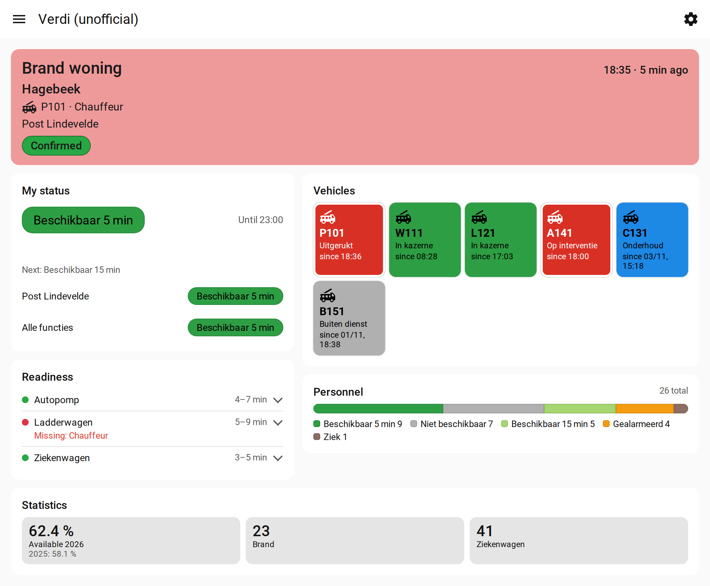

# Verdi HA (unofficial)

Verdi is Cevi's alerting and dispatching software for the fire service, used by the Belgian emergency
service zones (hulpverleningszones). This integration brings your station's Verdi data and your own
status into Home Assistant, using your own Verdi account. You can show it on a dashboard, use it in
automations, or look at it on the integration's own status page.

## What you get

**Your station**

- **Readiness:** whether each vehicle train is complete, and which positions are filled.
- **Vehicles:** the status of each vehicle, and whether it's on an intervention.
- **Personnel:** how many people have each availability.
- **Team on duty:** the current team, the next team and when they change.
- **Crew functions:** whether each function is filled right now. Colleagues' names only if you allow them.
- **Roster calendar:** the shifts of a function calendar (optional).

**You**

- **My availability:** your current status and how long it lasts.
- **Paged:** turns on when you're paged, with the incident, city, vehicle and your function.
- **Pre-alert** and **garrison:** whether you have a pre-alert, or are on garrison (both off by default).
- **Statistics:** your availability % this year, and how often you were called.
- **Calendars:** your shifts and your availability, about a month ahead.

**Optional: change your status.** Add an exception or return to planning from Home Assistant, with
buttons or from an automation. This is off by default.

You can turn each part on or off in the integration's options. The full list is on the
[entities](https://github.com/jertech/verdi-ha/blob/main/docs/entities.md) page.

## Status page

The integration adds a **Verdi (unofficial)** page to the sidebar. It shows your status, readiness,
vehicles, personnel and statistics in Verdi's own colours, and a red banner while you're paged. Each
user can choose their own layout. See [status page](https://github.com/jertech/verdi-ha/blob/main/docs/status-page.md).

<picture>
  <source media="(prefers-color-scheme: dark)" srcset="https://raw.githubusercontent.com/jertech/verdi-ha/main/docs/images/status-page-paged-wide-dark.png">
  
</picture>

*The status page while you're paged. All names and places are made up.*

## How it works

Verdi only lets you in through your zone's login, with MFA. So the setup has two parts:

- The **integration** reads your data from Verdi: every minute by default, every 30 seconds during
  an intervention. It only reads, unless you turn on "Change my status".
- The **Verdi Token Relay** app keeps you logged in and hands the integration a fresh token. You log
  in once on a PC; after that the app renews the login itself.

## Requirements

- Home Assistant 2026.4 or later.
- Home Assistant OS, for the Token Relay app. On other installs, run the
  [standalone relay](https://github.com/jertech/verdi-ha/blob/main/docs/standalone-relay.md) on any machine that can keep a container or service running.
- A PC with a screen and Python 3.11 or later, for the one-time login (Windows, macOS or Linux).

## Installation

<!-- ha-marketplace:exclude-start -->
### 1. Install the integration

In **Settings > Marketplace** (Home Assistant 2026.11 or later) or in **HACS** (before 2026.11), search
for **Verdi (unofficial)** and install it. Restart Home Assistant when it asks.

[](https://my.home-assistant.io/redirect/hacs_repository/?owner=jertech&repository=verdi-ha&category=integration)

<details>
<summary>Not in the search results? Add it as a custom repository</summary>

Open the menu in the Marketplace or in HACS, choose **Custom repositories**, and add
`https://github.com/jertech/verdi-ha` with type **Integration**. The Marketplace needs a GitHub
connection for custom repositories.

</details>

<!-- ha-marketplace:exclude-end -->
Besides the integration, you need the Token Relay app and a one-time login on a PC.

### 2. Install the Token Relay app

1. Go to **Settings > Apps > App store** (called *Add-on store* in older versions), open the menu,
   choose **Repositories** and add `https://github.com/jertech/verdi-ha`.
2. Install **Verdi Token Relay**. Don't start it yet.

### 3. One-time login on a PC

Your zone's login uses MFA, so the first login has to happen in a real browser. Download this
repository on your PC (**Code > Download ZIP** on GitHub) and open a terminal in its folder.

You need two values:

- your Verdi address, the one you open in the browser, for example `https://yourzone.verdi.cloud`;
- your tenant name ([how to find it](https://github.com/jertech/verdi-ha/blob/main/docs/finding-your-ids.md#tenant-name-for-the-token-relay)).

Linux or macOS:

```sh
python3 -m venv ~/.venvs/verdi
. ~/.venvs/verdi/bin/activate
pip install playwright==1.64.1
playwright install chromium
export VERDI_URL=https://yourzone.verdi.cloud VERDI_TENANT=YourTenant VERDI_STATE=~/verdi_state.json
python verdi_token_relay/verdi_token_relay.py login
```

Windows (Command Prompt):

```bat
py -m venv %USERPROFILE%\.venvs\verdi
%USERPROFILE%\.venvs\verdi\Scripts\activate
pip install playwright==1.64.1
playwright install chromium
set VERDI_URL=https://yourzone.verdi.cloud
set VERDI_TENANT=YourTenant
set VERDI_STATE=%USERPROFILE%\verdi_state.json
python verdi_token_relay\verdi_token_relay.py login
```

A browser window opens. Sign in as you normally do. The script then saves your login in
`verdi_state.json` in your home folder. **Treat that file like a password.**

### 4. Give the login to the app

1. Copy `verdi_state.json` into the app's configuration folder, for example with the Samba app:
   the Verdi Token Relay's folder in the `apps_configs` share.
2. In the app's **Configuration** tab, fill in your Verdi address and tenant, then start the app.

The app moves the file into its private data folder and deletes your copy. Until you finish step 5,
its log says "Home Assistant has no /api/verdi/token yet". That is expected.

### 5. Add the integration

[](https://my.home-assistant.io/redirect/config_flow_start/?domain=verdi)

Go to **Settings > Devices & services > Add integration > Verdi (unofficial)**. Accept the notice, then
enter your Verdi address and the IDs of your station ([how to find them](https://github.com/jertech/verdi-ha/blob/main/docs/finding-your-ids.md)).

The app delivers a token within about 90 seconds. Until then the integration shows "retrying setup".

To change what the integration shows and how often it checks, press **Configure** on the integration.
See [configuration](https://github.com/jertech/verdi-ha/blob/main/docs/configuration.md).

## When the login stops working

Sometimes Verdi needs you to log in again, for example after you change your password. Home Assistant
then asks you to re-authenticate. Repeat steps 3 and 4, and restart the app.

## More documentation

- [Entities](https://github.com/jertech/verdi-ha/blob/main/docs/entities.md): every entity and its attributes
- [Status page](https://github.com/jertech/verdi-ha/blob/main/docs/status-page.md): the page, its layouts and settings
- [Changing your status](https://github.com/jertech/verdi-ha/blob/main/docs/changing-status.md): actions, buttons and example automations
- [Configuration](https://github.com/jertech/verdi-ha/blob/main/docs/configuration.md): all options, and how often the integration polls Verdi
- [Privacy](https://github.com/jertech/verdi-ha/blob/main/docs/privacy.md): what is stored in Home Assistant, and what you should protect
- [Token relay](https://github.com/jertech/verdi-ha/blob/main/docs/token-relay.md): how the token gets to Home Assistant
- [Standalone relay](https://github.com/jertech/verdi-ha/blob/main/docs/standalone-relay.md): without Home Assistant OS
- [Remote Calendar](https://github.com/jertech/verdi-ha/blob/main/docs/remote-calendar.md): subscribe to Verdi's calendar feed instead
- [Finding your IDs](https://github.com/jertech/verdi-ha/blob/main/docs/finding-your-ids.md)
- [Verdi requests used](https://github.com/jertech/verdi-ha/blob/main/docs/endpoints.md)

## Security

Please report vulnerabilities privately; see [SECURITY.md](https://github.com/jertech/verdi-ha/blob/main/SECURITY.md). Never post tokens,
`verdi_state.json`, HAR files, screenshots of the browser's network tab, IDs or names in issues.

## Disclaimer

Unofficial, not affiliated with Cevi or Verdi, not for operational use, uses your own Verdi account
and its permissions, use at your own risk. See [DISCLAIMER.md](https://github.com/jertech/verdi-ha/blob/main/DISCLAIMER.md) and
[ADDITIONAL_TERMS.md](https://github.com/jertech/verdi-ha/blob/main/ADDITIONAL_TERMS.md).

## License

Copyright (C) 2026 jertech and contributors.

This program is free software: you can redistribute it and/or modify it under the terms of the
GNU General Public License as published by the Free Software Foundation, either version 3 of the
License, or (at your option) any later version, with the additional terms in
[ADDITIONAL_TERMS.md](https://github.com/jertech/verdi-ha/blob/main/ADDITIONAL_TERMS.md). See [LICENSE](https://github.com/jertech/verdi-ha/blob/main/LICENSE) and [NOTICE](https://github.com/jertech/verdi-ha/blob/main/NOTICE).
