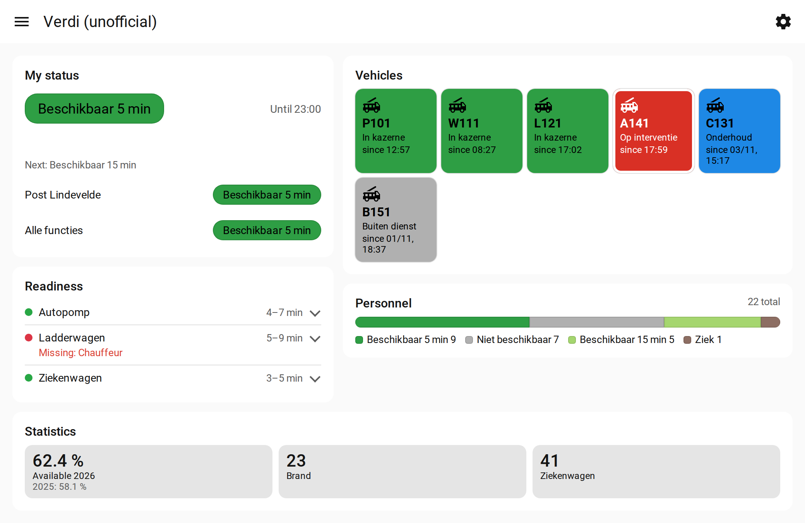
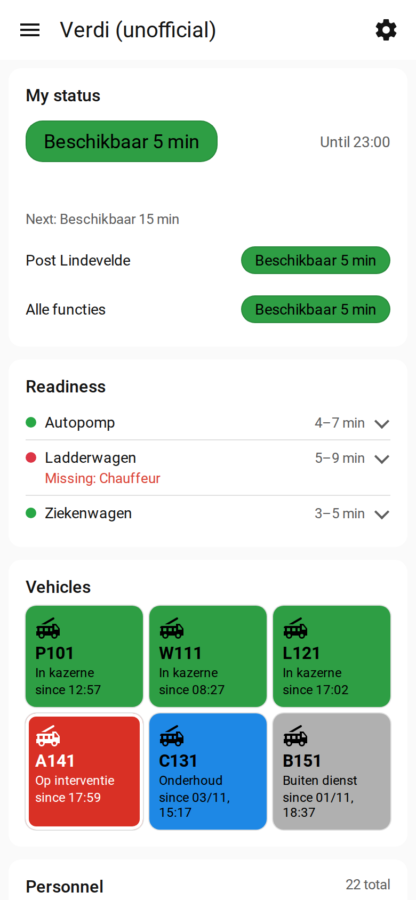
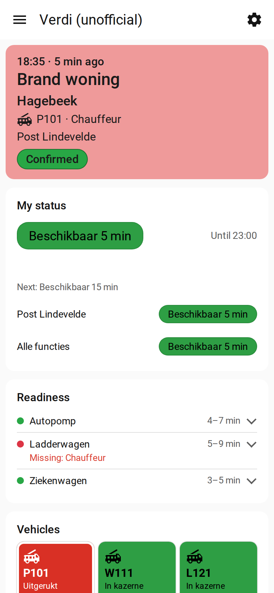

# Status page

The integration adds a **Verdi (unofficial)** page to the Home Assistant sidebar. You don't need to set
anything up for it.

<picture>
  <source media="(prefers-color-scheme: dark)" srcset="images/status-page-normal-wide-dark.png">
  
</picture>

*On a wide screen, Overview preset. All names and places are made up.*

<table>
  <tr>
    <td width="50%">
      <picture>
        <source media="(prefers-color-scheme: dark)" srcset="images/status-page-normal-phone-dark.png">
        
      </picture>
    </td>
    <td width="50%">
      <picture>
        <source media="(prefers-color-scheme: dark)" srcset="images/status-page-paged-phone-dark.png">
        
      </picture>
    </td>
  </tr>
  <tr>
    <td align="center"><em>On a phone</em></td>
    <td align="center"><em>On a phone, while you're paged</em></td>
  </tr>
</table>

## What's on it

- **My status:** your current availability and until when. Your next status shows when your planning has
  one for the moment the current one ends; a status from a recurring planning doesn't show there. Your planning is
  fetched again 10 to 15 minutes before your current status ends, so a change you made in the Verdi app shows there
  by then. The pre-alert and garrison tags show here when those options are on.
- **Readiness:** each vehicle train and whether it's complete. Tap a train to see its positions.
- **Vehicles:** the status of each vehicle.
- **Personnel:** how many people have each availability.
- **Statistics:** your availability % and how often you were called.

Statuses use the same colours as in Verdi. The colours come from Verdi itself, so they're right for
every zone, and a colour changed in Verdi shows up on the next update.

Names of statuses, vehicles and trains are as your zone has them in Verdi. The rest of the page follows
the language in your Home Assistant profile (Dutch, French or English; otherwise English). See
[language](configuration.md#language).

## When you're paged

A red banner at the top shows the incident, the time of the alarm and how many minutes ago that was,
the city, the vehicle, your function, the station, and whether you've confirmed. You can turn the banner
off in the page settings.

## Page settings

Open them with the gear icon at the top of the page.

1. Pick **Phone** or **Wide**. Each has its own settings, so the page can look different on your phone
   and on a big screen.
2. Pick a preset: **Overview**, **Board** or **List**.
3. Change what you like:
   - which blocks show, and in what order (drag them, or use the arrows);
   - on a wide screen, whether a block is on the left, on the right or full width;
   - how each block looks:

     | Block | Choices |
     |-------|---------|
     | Vehicles | Colour tiles, tiles with a coloured border, list |
     | Readiness | Lines, chips |
     | Personnel | Bar, pills |
     | Statistics | Separate numbers, rows |

   - whether the paged banner shows.

Settings are saved per Home Assistant user and per station, so they follow you to other browsers and to
the Companion app.

## Changing your status from the page

With **Change my status** on, a Home Assistant administrator can tap the large status on the page to add
an exception or return to planning. When Verdi refuses the change, a fixed planning overrules it, or the
result couldn't be checked, the dialog says so and keeps showing Verdi's answer. For other users the status is not clickable. See
[changing your status](changing-status.md).

## History

Tap a vehicle, or **History** under an opened train, to see that day's changes on a timeline. It shows
what Home Assistant kept: 10 days by default, set by Home Assistant's recorder. A train's times are the
moments Home Assistant saw the change.

Home Assistant's own history graphs use Home Assistant's colours, not Verdi's. Home Assistant has no
setting for that.

## Vehicle icons

To give a vehicle its own icon, set one on its entity under **Settings > Devices & services > Entities**.
The page uses it.

## When something is wrong

When data is missing or may be out of date, a line at the top of the page says why:

- the login expired;
- Verdi asked the integration to slow down;
- Verdi can't be reached;
- one lookup failed, so some data may be out of date.

The page checks this once a minute while it's open. Failed lookups retry by themselves.

When the integration is updated while the page is open (the Companion app keeps it open), the page says
"Verdi was updated. Reload to see the changes." Press **Reload**.

## Who can see the page

Every Home Assistant user can open it. It shows the availabilities you chose in the options and no
colleagues' names. Entities you hide in Home Assistant don't show on the page.
